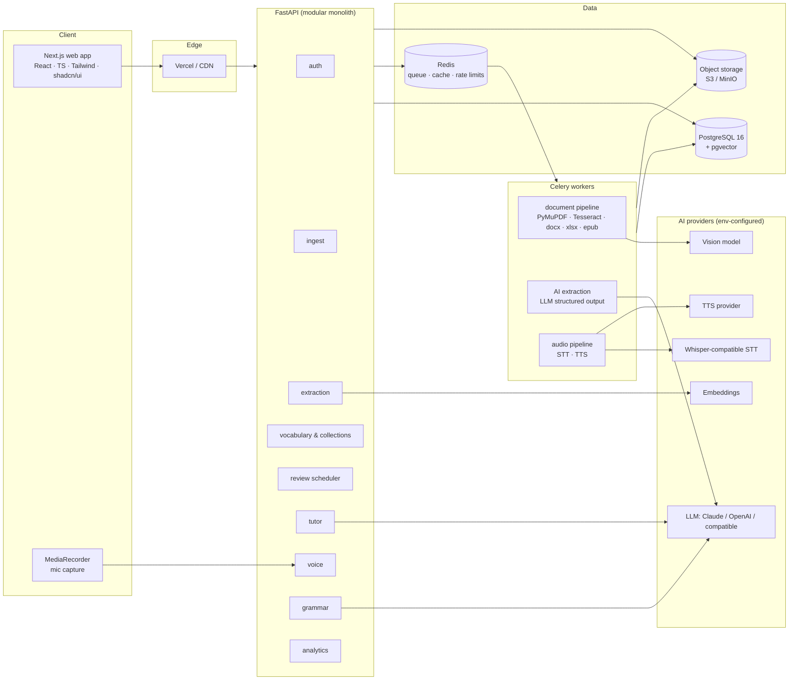
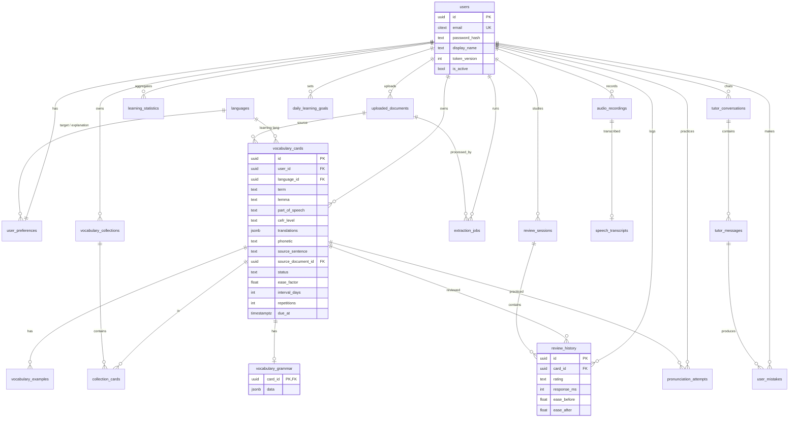
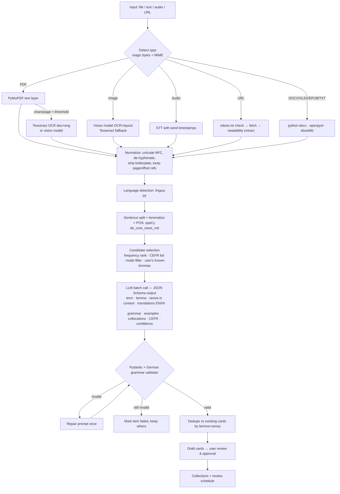

# SmartVocab AI — System Architecture

Version 0.1 · Phase 1 baseline · 2026-11-01

This document covers the ten items requested before implementation:
architecture, diagram, folder structure, ER diagram, API docs, AI workflow,
model/provider choices, roadmap, dependencies and infrastructure sizing.

---

## 1. System architecture

SmartVocab AI is a **modular monolith** with an asynchronous worker tier.
One FastAPI codebase, split into bounded modules (`auth`, `ingest`,
`extraction`, `vocabulary`, `review`, `tutor`, `voice`, `grammar`,
`analytics`). Each module owns its routes, services, schemas and models and
talks to others only through service functions. This keeps deployment simple
now and lets a module (e.g. ingestion) be split into its own service later
without rewriting it.

Key design decisions:

| Decision | Choice | Why |
|---|---|---|
| Service shape | Modular monolith + Celery workers | One deployable, clear seams, heavy work off the request path |
| AI access | `AIProvider` / `STTProvider` / `TTSProvider` / `OCRProvider` interfaces | Swap OpenAI, Anthropic, local Whisper, Azure TTS etc. via env vars |
| AI output | JSON Schema-constrained generation + Pydantic validation + one repair retry | Cards are data, not prose; invalid output never reaches the DB |
| Language support | `languages` table + per-language **grammar plugins** (`grammar/de.py`) | German grammar fields live in JSONB, validated by a language-specific Pydantic model, so adding Spanish = new plugin, no schema migration |
| Scheduling | `Scheduler` interface, SM-2 implementation first | Transparent rules now, FSRS or a learned model later |
| Files | S3-compatible object storage (MinIO locally) | Originals kept as learning references; DB stores keys only |
| Auth | Argon2/bcrypt hashes, short-lived JWT access token in httpOnly cookie, `token_version` for server-side revocation | No tokens in JS-readable storage; logout invalidates all sessions |
| Isolation | Every user-owned row carries `user_id`; every query goes through a repository scoped by the authenticated user | Prevents cross-user reads by construction |
| Search | PostgreSQL full-text + `pgvector` embeddings (Phase 9) | One database, no extra vector store to run |

### Request lifecycle (upload → cards)

1. Client uploads a file → `POST /uploads/*` validates type/size/magic bytes,
   stores the original in object storage, creates `uploaded_documents` +
   `extraction_jobs (status=queued)` and returns the job id.
2. A Celery worker picks up the job: extract → clean → detect language →
   chunk → LLM extraction → validate → dedupe against the user's existing
   vocabulary → write **draft** cards.
3. Client polls `GET /jobs/{id}` (or SSE) for progress.
4. User reviews drafts on the results page and approves; approved cards are
   added to a collection and enter the review schedule.

---

## 2. Architecture diagram



---

## 3. Project folder structure

```
smartvocab-ai/
├── docker-compose.yml
├── .env.example
├── PROGRESS.md                     # phase checklist, updated per phase
├── docs/
│   └── ARCHITECTURE.md
├── backend/
│   ├── Dockerfile
│   ├── pyproject.toml
│   ├── alembic.ini
│   ├── alembic/
│   │   ├── env.py
│   │   └── versions/0001_initial_schema.py
│   ├── app/
│   │   ├── main.py                 # app factory, middleware, routers
│   │   ├── core/
│   │   │   ├── config.py           # pydantic-settings, all env vars
│   │   │   ├── security.py         # hashing, JWT
│   │   │   ├── errors.py           # error envelope + handlers
│   │   │   ├── logging.py
│   │   │   └── rate_limit.py
│   │   ├── db/
│   │   │   ├── base.py             # Declarative base, UUID/timestamp mixins
│   │   │   ├── session.py
│   │   │   └── seed.py             # languages + default collections
│   │   ├── models/                 # SQLAlchemy models (all 20 tables)
│   │   ├── schemas/                # Pydantic request/response models
│   │   ├── api/
│   │   │   ├── deps.py             # current_user, db session
│   │   │   └── routes/             # auth, users, vocabulary, collections, analytics, health
│   │   ├── services/               # business logic, user-scoped
│   │   ├── ai/                     # Phase 3+: providers/, prompts/, schemas/, pipeline.py
│   │   ├── ingest/                 # Phase 2: pdf.py, image.py, url.py, docx.py …
│   │   ├── grammar/                # Phase 8: base.py, de.py
│   │   ├── review/                 # Phase 7: scheduler.py (SM-2)
│   │   └── workers/                # Celery app + tasks
│   └── tests/
├── frontend/
│   ├── Dockerfile
│   ├── package.json
│   ├── next.config.mjs
│   ├── tailwind.config.ts
│   ├── src/
│   │   ├── app/
│   │   │   ├── (marketing)/page.tsx      # landing
│   │   │   ├── (auth)/login, register
│   │   │   └── (app)/dashboard, vocabulary, collections, settings …
│   │   ├── components/ui/                # shadcn-style primitives
│   │   ├── components/                   # app components
│   │   ├── lib/api.ts                    # typed API client
│   │   └── lib/types.ts
│   └── middleware.ts                     # route protection
└── infra/                                # Phase 10: deploy manifests, backups
```

---

## 4. Database ER diagram

All primary keys are UUIDs; every table has `created_at`/`updated_at`
(timestamptz). User-owned tables cascade on user deletion so account deletion
is a single `DELETE FROM users`.



Notable indexes: `vocabulary_cards (user_id, due_at)` for the review queue,
`(user_id, language_id, lemma)` unique for duplicate detection,
`review_history (user_id, reviewed_at)` for analytics, GIN on
`translations`, `extraction_jobs (status, created_at)` for workers.

Scheduling state lives on `vocabulary_cards` (one row per card, hot path);
`review_history` is the append-only log used to recompute or migrate to a new
memory model.

---

## 5. API endpoint documentation

Base path `/api/v1`. Live OpenAPI docs at `/docs` (Swagger) and `/redoc`.
Errors use one envelope: `{"error": {"code": "...", "message": "...", "details": ...}}`.

| Method | Path | Phase | Purpose |
|---|---|---|---|
| POST | /auth/register | 1 ✅ | Create account, set session cookie |
| POST | /auth/login | 1 ✅ | Verify credentials, set session cookie |
| POST | /auth/logout | 1 ✅ | Revoke all sessions (bumps token_version) |
| GET | /users/me | 1 ✅ | Current user + preferences |
| PATCH | /users/me/preferences | 1 ✅ | Explanation language, CEFR level, daily goal, theme |
| DELETE | /users/me | 1 ✅ | Delete account and all data |
| GET | /vocabulary | 1 ✅ | List/search/filter cards (paginated) |
| POST | /vocabulary | 1 ✅ | Manual card entry |
| GET | /vocabulary/{id} | 1 ✅ | Card detail |
| PUT | /vocabulary/{id} | 1 ✅ | Edit card |
| DELETE | /vocabulary/{id} | 1 ✅ | Delete card |
| GET | /collections | 1 ✅ | List collections with card counts |
| POST | /collections | 1 ✅ | Create collection |
| GET | /analytics/dashboard | 1 ✅ | Real counts from the user's data |
| GET | /health | 1 ✅ | DB + Redis readiness |
| POST | /uploads/pdf · image · audio · document · text · url | 2 | Ingest, returns job id |
| GET | /jobs/{id} | 2 | Extraction progress |
| POST | /ai/extract-vocabulary | 3 | Synchronous extraction for short text |
| POST | /ai/generate-flashcards | 3 | Draft cards from extracted terms |
| POST | /ai/explain-word | 3 | Contextual explanation |
| POST | /ai/compare-words | 8 | e.g. wissen vs. kennen |
| POST | /ai/generate-quiz | 4 | Quiz items from a collection |
| POST | /voice/transcribe | 5 | STT |
| POST | /voice/analyze-pronunciation | 5 | Pronunciation scoring |
| POST | /voice/generate-audio | 5 | TTS, cached per term |
| GET | /reviews/due | 7 | Due queue |
| POST | /reviews/submit | 7 | Again/Hard/Good/Easy |
| GET | /reviews/statistics | 7 | Retention stats |
| POST | /tutor/chat | 6 | Streamed tutor reply |
| GET | /tutor/history | 6 | Conversations |
| GET | /analytics/progress | 7 | Time series |
| GET | /export/{format} | 4 | CSV, XLSX, JSON, Anki (.apkg/TSV) |

---

## 6. AI processing workflow



Rules that keep the output honest:

- **spaCy decides lemma and POS; the LLM explains.** The LLM's grammar is
  cross-checked (article ∈ {der, die, das}, auxiliary ∈ {haben, sein},
  Perfekt contains a Partizip II) and low-confidence items are flagged.
- **Sense disambiguation uses the source sentence**, so `Bank` (bench) and
  `Bank` (bank) become separate cards keyed by lemma + sense.
- **Grammar fields are conditional**: the schema is a discriminated union on
  part of speech, so a noun card can't carry verb conjugation.
- Prompts are versioned files; `extraction_jobs` stores model + prompt
  version for every card it produced.
- Users can correct any field; corrections are stored and can feed evals.

---

## 7. Recommended models and providers

Everything is selected by env var; these are starting defaults, not lock-in.

| Task | Default | Alternatives | Notes |
|---|---|---|---|
| Extraction, grammar, tutor | Anthropic Claude Sonnet (latest) | OpenAI GPT-4.1-class, Mistral Large, self-hosted Qwen/Llama via OpenAI-compatible API | Needs strong German + reliable structured output |
| Cheap bulk passes (candidate ranking, quiz generation) | Claude Haiku (latest) | GPT-4.1-mini, small open models | Cost control for large PDFs |
| Image understanding / handwriting | Claude or GPT vision models | Google Document AI | Tesseract `deu` stays as offline fallback |
| Speech-to-text | OpenAI Whisper API or `faster-whisper large-v3` self-hosted | Deepgram, Azure Speech | Self-hosting on a GPU is cheaper at scale |
| Pronunciation scoring | Azure Speech Pronunciation Assessment | Phoneme-level alignment with wav2vec2 | Azure gives per-phoneme scores for de-DE out of the box |
| Text-to-speech | Azure Neural TTS (de-DE voices) | OpenAI TTS, ElevenLabs, Piper (local) | Cache audio per (term, voice) in object storage |
| Embeddings | OpenAI text-embedding-3-small | Cohere multilingual, `multilingual-e5` local | For semantic dedupe/search |
| Language detection | lingua-py (local) | fastText lid.176 | No API cost |
| Lemma/POS | spaCy `de_core_news_md` | Stanza | Deterministic, fast |

Model names should be verified against provider docs at configuration time
because model lineups change frequently.

---

## 8. Development roadmap

| Phase | Scope | Exit criteria |
|---|---|---|
| 1 Foundation | Repo, Docker Compose, full DB schema + migration, auth, preferences, manual vocabulary CRUD, collections, real dashboard | Tests green on Postgres; register→login→add card→dashboard reflects it |
| 2 Multimodal input | Upload endpoints, object storage, Celery, PDF/OCR/image/text/URL/DOCX/XLSX/EPUB | Each format produces cleaned text with source refs; jobs report progress |
| 3 AI engine | Provider interfaces, prompts, structured extraction, validation, dedupe, approval UI | Golden-set eval: ≥95% valid JSON, article accuracy ≥98% on test nouns |
| 4 Flashcards | Card UI, editor, collections ops, search, export (CSV/XLSX/JSON/Anki), quiz types | Export round-trips; every quiz type playable |
| 5 Voice | Recorder, waveform, STT, speak-to-flashcard, TTS, pronunciation | Spoken sentence → saved cards with audio |
| 6 Tutor | Free + vocabulary-targeted modes, corrections, mistake tracking, voice mode | Tutor uses due/weak words; mistakes logged |
| 7 Revision | SM-2 scheduler, due queue, retention estimate, analytics time series | Scheduler unit-tested against reference intervals |
| 8 Grammar | Grammar module, case/preposition detection, comparisons | Explanations for listed topics; compare endpoint |
| 9 Real-life learning | Capture flows, novelty vs known words, daily recommendations | New-word detection excludes known lemmas |
| 10 Production | E2E tests, security review, perf, backups, deploy docs | Load test + backup restore drill pass |

---

## 9. Required dependencies

**Backend (Python 3.12+)**: fastapi, uvicorn[standard], pydantic v2,
pydantic-settings, sqlalchemy 2, alembic, psycopg[binary] 3, bcrypt, pyjwt,
redis, celery, email-validator, python-multipart; Phase 2+: pymupdf,
pytesseract, python-docx, openpyxl, ebooklib, beautifulsoup4, trafilatura,
python-magic; Phase 3+: anthropic and/or openai SDK, spacy +
de_core_news_md, lingua-language-detector, pgvector; Phase 5: azure-cognitiveservices-speech
(optional), pydub/ffmpeg. Dev: pytest, httpx, ruff, mypy.

**Frontend (Node 20+)**: next 14+, react 18, typescript, tailwindcss,
class-variance-authority, clsx, tailwind-merge, lucide-react, framer-motion,
@radix-ui primitives (shadcn/ui), recharts, zod.

**System**: PostgreSQL 16 (+pgvector), Redis 7, Tesseract 5 with `deu`
and `eng` traineddata, ffmpeg, MinIO (dev) or S3.

---

## 10. Estimated infrastructure requirements

| Stage | Users | Setup | Rough monthly cost (EUR) |
|---|---|---|---|
| Dev / personal | 1–10 | Docker Compose on one 2 vCPU / 4 GB VM, or local | 0–15 + AI usage |
| Beta | ≤1,000 | Vercel (frontend), 1× API (2 vCPU/4 GB), 1× worker (2 vCPU/4 GB), managed Postgres (2 GB), managed Redis (256 MB), S3 50 GB | ~80–150 + AI usage |
| Growth | ≤20,000 | 2–3 API replicas, 3–6 workers (autoscaled on queue depth), Postgres 4 vCPU/16 GB + read replica, Redis 1 GB, CDN for audio | ~400–900 + AI usage |

AI usage dominates cost. Planning figures to validate with real usage:
extracting ~30 cards from a 10-page PDF ≈ 15–25k LLM tokens; a 10-minute
tutor session ≈ 20–40k tokens; TTS audio is generated once per term and
cached. Per-user monthly AI quotas are enforced in Redis.
Self-hosting Whisper needs one GPU worker (e.g. 16–24 GB VRAM) once audio
volume justifies it.
